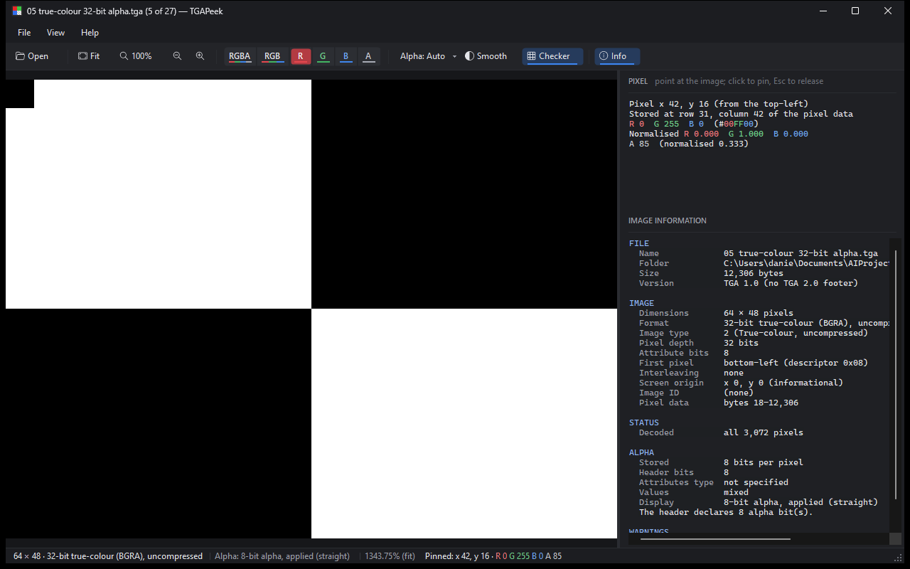
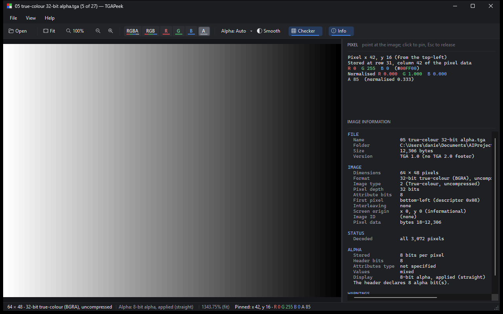

# TGAPeek

A small, fast TGA viewer for Windows, made for game artists who are sick of waiting for Photoshop to boot up just to check a texture.


## Why I made it

If you work on game art you open TGAs all day: checking an export, looking at what's packed into the alpha, or making sure a mask actually came out the way you painted it. Windows can't open them properly, and launching Photoshop every time gets old fast.

TGAPeek opens almost instantly, shows you exactly what's in the file, and gets out of the way. It's a viewer, so it never edits or re-saves anything.

## What it does

- **Look at each channel on its own.** Flip between RGBA, RGB, R, G, B and A with one click or a shortcut. Great for checking packed masks (roughness/metal/AO and the like) or seeing what's really in the alpha.
- **Inspect any pixel.** Hover to see its exact values, click to pin it. The values come straight from the file, not from what's on screen.
- **No surprise colour changes.** No colour management, no gamma tweaks. What's stored in the file is what you see.
- **Alpha handled properly.** Straight and premultiplied alpha both work, and the status bar tells you how alpha is being shown and why. You can always force it on or off.
- **Crisp pixels when you zoom in**, with a smooth option if you'd rather. Zoom and pan stay fast even on huge textures.
- **Flick through a folder** with the arrow keys, or drag a bunch of files in at once.
- **Handles weird files.** Opens pretty much every flavour of TGA, and if a file is broken or cut short it tells you what's wrong instead of crashing.
- **Dark UI**, with channel buttons colour-coded like you'd expect from a game engine.

<p>
  
  
</p>

## Getting it

Grab `TGAPeek.exe` from the [Releases](https://github.com/daniellfaber/TGAPeek/releases) page and run it. There's no installer and you don't need anything else installed. It works on 64-bit Windows 10 and 11.

The exe isn't code-signed yet, so Windows SmartScreen might warn you the first time. Click **More info ▸ Run anyway**. If you don't want to take my word for it, all the source code is right here, so feel free to have a look through it or build the exe yourself (see below).

**To make it your default TGA viewer:** right-click any `.tga` file, choose **Open with ▸ Choose another app**, pick `TGAPeek.exe`, and tick **Always**. Put the exe somewhere permanent first, so it doesn't break if you tidy up your Downloads folder.

## Handy shortcuts

| | |
|---|---|
| Next / previous image | Left / Right |
| Fit to window / 100% | Ctrl+0 / Ctrl+1 (or double-click) |
| Zoom / pan | Mouse wheel / drag |
| RGBA / RGB | Ctrl+2 / Ctrl+3 |
| Red / Green / Blue / Alpha | Ctrl+4 / 5 / 6 / 7 |
| Checkerboard on/off | Ctrl+B |
| Info panel (headers, metadata, pixel details) | F9 |

## Building it yourself

You'll need the .NET 10 SDK.

```
dotnet build -c Release
dotnet test -c Release
dotnet publish src/TGAPeek.App -p:PublishProfile=win-x64-self-contained
```

The more detailed docs live in [docs/](docs/), including the full [list of supported formats](docs/FORMAT_COVERAGE.md).

## Licence

MIT, see [LICENSE](LICENSE). Third-party notices are in [THIRD-PARTY-NOTICES.md](THIRD-PARTY-NOTICES.md).
