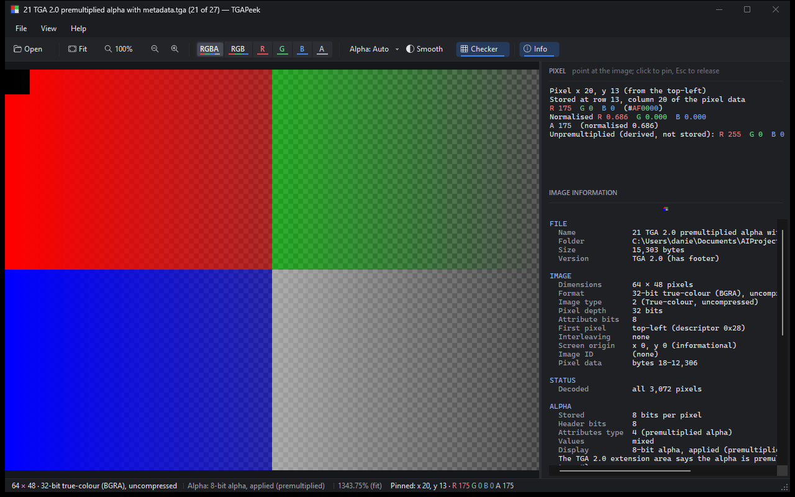

# TGAPeek design system

This is the reference for how TGAPeek looks and why. Read it before changing anything visual, and add the owner's feedback to the [feedback log](#12-feedback-log) as it arrives. The tokens below are defined in code in [`src/TGAPeek.App/Theme.cs`](../src/TGAPeek.App/Theme.cs); if the two ever disagree, fix whichever is wrong and note it in the log.

**Scope:** visual design only. Behaviour, data handling and decoding are governed by the [project brief](PROJECT_BRIEF.md), [IMPLEMENTATION_PLAN.md](IMPLEMENTATION_PLAN.md) and [CLAUDE.md](../CLAUDE.md). A visual change must never alter what the viewer does or what it shows of the image.

## 1. Intent

TGAPeek is a technical tool for inspecting game textures. Its look should feel like the dark editors texture artists already work in, such as Unreal Engine's editor and Windows' own dark mode: quiet, precise and professional.

- **Dark only.** There is no light theme; every surface is dark.
- **The image comes first.** The image is the brightest and most saturated thing on screen; the chrome around it is dark, low-contrast and neutral, so it never competes with the texture or tints the viewer's perception of it.
- **Quiet chrome, meaningful colour.** Colour in the interface is reserved for meaning: red, green, blue and grey for channels, blue for "on" or selected, amber for warnings. Nothing is coloured for decoration.
- **A fast utility, not an editor.** The layout stays minimal (brief §5): one toolbar, one optional side panel, one status bar.

## 2. Principles

1. **Never alter the measurement.** Styling must not touch pixel data, compositing or the inspector's values. The inspector's and report's text is exactly what the Core produces; styling only adds colour to it.
2. **Colour is never the only cue.** Every coloured state also has a shape or text cue: channel buttons keep their letters, toggles that are on get an underline as well as a fill, menu checks get a tick.
3. **Exactness rule: no pure primaries or pure greys in the chrome.** No interface colour is pure red, green or blue (`#FF0000`, `#00FF00`, `#0000FF`), black, white or a pure grey. Neutrals are tinted very slightly cool (blue a few steps higher than red). This keeps chrome pixels from being mistaken for image pixels; the end-to-end test counts exact pixel colours in the window and relies on it. It also stops anti-aliased text from producing exact greys.
4. **Native and light.** The Windows UI font (Segoe UI), Windows' built-in icon font, a dark native title bar and dark native scroll bars. No external assets, packages or images.
5. **DPI-aware.** Every size below is in logical pixels at 100% scaling, converted with `LogicalToDeviceUnits`, and icons are redrawn when the window moves to a monitor with different scaling.

## 3. Colour tokens

Surfaces, darkest to lightest:

| Token | Hex | Use |
|---|---|---|
| `Canvas` | `#16171A` | Behind the image, and the empty window |
| `Chrome` | `#1C1D21` | Title bar, menu bar, status bar, warning banner |
| `Panel` | `#1F2024` | Information panel and its text areas |
| `Toolbar` | `#232428` | Toolbar |
| `Control` | `#2C2E33` | Drop-down menus, channel control, message cards |
| `Hover` | `#37393F` | Anything under the pointer |
| `Pressed` | `#42454C` | A button being pressed |
| `Divider` | `#2A2C31` | Lines between areas, panel splitter |
| `Border` | `#35373D` | Menu and card outlines, status-bar dividers |

Text and state:

| Token | Hex | Use | Contrast |
|---|---|---|---|
| `Text` | `#E4E5E9` | Primary text and icons | 12.9:1 on `Panel` |
| `TextMuted` | `#9B9EA8` | Secondary text: report field names, shortcuts, status details, section titles | 6.1:1 on `Panel` |
| `TextFaint` | `#6A6D76` | Hints only (never essential information) | 3.1:1 on `Panel` |
| `TextOnFill` | `#F6F7F9` | Text on a filled (checked) channel button | at least 4.7:1 on every fill |
| `Heading` | `#8CB2F4` | Report section titles, menu tick | 7.6:1 on `Panel` |
| `Accent` | `#3D86F2` | Underline of toggles that are on | |
| `AccentFill` / `AccentFillHover` | `#263B5C` / `#2D466D` | Background of toggles that are on, menu check box | `Text` is 9.0:1 on it |
| `Warning` | `#F0B24A` | Warnings: status-bar link, banner edge and icon | 9.0:1 on `Chrome` |

Contrast ratios are WCAG 2 ratios, calculated from the hex values. Everything essential meets AA (4.5:1). `TextFaint` is deliberately below it, and is used only for hints that repeat information available elsewhere.

**Transparency checkerboard:** `CheckerLight #5A5A5A` and `CheckerDark #424242`, also used behind the postage stamp. These are pure greys on purpose. They are part of the image area, not the chrome, and must not tint semi-transparent pixels. They are set by the app (`DisplayOptions.CheckerLight` and `CheckerDark`); the Core's defaults are unchanged. Transparency stays clearly distinguishable from black (brief §4).

## 4. Channel colours

Each channel has one identity, used on its toolbar button and wherever its values are written (the pixel inspector and the status-bar readout).

| Channel | Text (values, button label) | Stripe (button identity) | Fill (button when active) |
|---|---|---|---|
| R | `#F2777C` | `#E5484F` | `#B33B42` |
| G | `#6FD08A` | `#43B562` | `#2E7D46` |
| B | `#6EA8F7` | `#3F86EC` | `#2E62B3` |
| A | `#C7CAD2` | `#A7ABB5` | `#5E616A` |
| RGB | `Text` | red, green and blue stripes | `#464A55` |
| RGBA | `Text` | red, green, blue and alpha stripes | `#464A55` |

The text colours are lightened so they read well on dark surfaces (at least 5.0:1). None is a pure primary (exactness rule). Alpha is a neutral light grey: it isn't a colour channel.

## 5. Typography

| Role | Font | Notes |
|---|---|---|
| Interface | Segoe UI 9 pt | Menus, toolbar, status bar, banners |
| Channel buttons | Segoe UI Semibold 9 pt | The letters must read at a glance |
| Section titles | Segoe UI Semibold 8.25 pt, capitals | Information-panel headers, in `TextMuted` |
| Empty window | Segoe UI 10.5 pt | The "open an image" hint |
| Values | Cascadia Mono 9 pt (Consolas if unavailable) | Pixel inspector and image report, where columns must line up |

## 6. Spacing and shape

- **Grid:** 4 px. Common gaps are 4, 8, 12 and 16.
- **Corner radius:** 4 px for buttons, menu highlights and the channel control; 6 px for message cards.
- **Toolbar:** 6 px side padding. Buttons have 8–10 px horizontal padding, and icon-only buttons 6 px. Groups are split by 1 px dividers with 4 px of space on each side.
- **Channel control:** segments 46 px wide for RGBA and RGB, 32 px for single letters, all 32 px high, touching, with rounded outer ends.
- **Information panel:** 12 px left padding for all content, 32 px section headers, 4 px splitter.
- **Status bar:** 8 px left padding; fields separated by 1 px `Border` dividers with 8 px of space.

## 7. Icons

Glyphs from Segoe Fluent Icons (Windows 11), falling back to Segoe MDL2 Assets (Windows 10; same code points). They are drawn at 16 px in `Text`.

| Action | Code point | Shape |
|---|---|---|
| Open | `E838` | Open folder |
| Fit | `E9A6` | Frame with corners |
| Actual pixels (100%) | `E71E` | Magnifier |
| Zoom out / in | `E71F` / `E8A3` | Magnifier with minus / plus |
| Smooth scaling | `E7A1` | Half-filled circle (softening). The sparkle icon was rejected because it implies "enhancement", which the viewer never does. |
| Checkerboard | `E80A` | Grid |
| Information panel | `E946` | Circled "i" |
| Empty window | `E91B` | Picture frame, 64 px, in `TextFaint` |
| Warning banner | `E7BA` | Triangle with "!", in `Warning` |
| Menu check | `E73E` | Tick, in `Heading` |
| Toolbar overflow | `E70D` | Chevron down |

## 8. Components

- **Title bar:** dark (Windows' immersive dark mode). On Windows 11 its colour, text and border match `Chrome`, `Text` and `Border`.
- **Menu bar and menus:** `Chrome` bar. Drop-downs are `Control` with a 1 px `Border` outline. The highlighted item is a rounded `Hover` fill, shortcuts are in `TextMuted`, and checked items get a tick on an `AccentFill` square.
- **Toolbar buttons:** an icon plus a label (zoom in and out are icon-only), on `Toolbar`.
  - Hover: rounded `Hover` fill. Pressed: `Pressed`.
  - Toggles that are on (Smooth, Checker, Info): `AccentFill` with a 2 px `Accent` underline.
- **Channel control** (RGBA, RGB, R, G, B, A): one segmented control, like the channel toggles in Unreal Engine's texture editor.
  - At rest: each segment is `Control`, with its label in the channel's text colour and a 2 px stripe in the channel's colour (several stripes for RGB and RGBA).
  - The active view: the segment fills with the channel's fill colour and the label turns `TextOnFill`.
  - Hover: an inner `Hover` fill.
- **Alpha drop-down:** label and arrow; `Hover`/`Pressed` fills like other buttons.
- **Status bar:** `Chrome`, with fields separated by thin `Border` dividers (a divider appears only while its field has text).
  - Text colours: the format in `Text`; alpha and zoom in `TextMuted`.
  - Pixel readout: its R, G, B and A values in their channel text colours.
  - Warnings: an amber link.
- **Information panel:** `Panel`, separated from the image by a 4 px splitter.
  - Sections: "Pixel" and "Image information", each with a capitalised header, an optional faint hint and a divider line.
  - **Pixel inspector:** channel values ("R 175", "G 0.502", "A 85") and each pair of a `#RRGGBB` code in their channel colours.
  - **Image report:** section titles (FILE, IMAGE…) in `Heading`; field names in `TextMuted`; values in `Text`.
  - Both use dark scroll bars.
- **Image area:**
  - **Background:** `Canvas`.
  - **Empty window:** a large faint picture icon above the hint.
  - **Warning banner** (partial images, invalid palette indices): a `Chrome` strip with an amber left edge and icon.
  - **Message card** (for example "This file stores no alpha channel…"): a rounded `Control` card with a `Border` outline.

## 9. States

| State | Look |
|---|---|
| Rest | No fill (toolbar and menus) or `Control` (channel segments) |
| Hover | `Hover` fill |
| Pressed | `Pressed` fill |
| On / checked | `AccentFill` and `Accent` underline (toggles); channel fill and `TextOnFill` (channel segments); tick (menus) |
| Disabled | `TextFaint` text (no items are currently disabled) |

## 10. Not themed: Windows' own windows

These are Windows system windows, which a Windows Forms app can't restyle without replacing them. Replacing them would change behaviour (keyboard handling, copying, sounds, accessibility), so they were left alone:

- **Message boxes:** keyboard and mouse help (F1), About, error and "cannot open" messages. They stay in Windows' light style.
- **Open and colour dialogs:** they follow Windows' own app colour mode (the open dialog turns dark when Windows is set to dark mode).
- **Tooltips:** the standard light Windows tooltips.
- **On Windows 10:** the title bar turns dark, but its exact colour can't be set (that needs Windows 11).

## 11. Implementation map

| File | Holds |
|---|---|
| [`Theme.cs`](../src/TGAPeek.App/Theme.cs) | Colour tokens, channel styles, fonts, icon glyphs, rounded shapes, and the native dark title bar and scroll bars |
| [`DarkRenderer.cs`](../src/TGAPeek.App/DarkRenderer.cs) | How the menus, toolbar, channel control and status bar are painted (a Windows Forms `ToolStripRenderer`) |
| [`SectionHeader.cs`](../src/TGAPeek.App/SectionHeader.cs) | Information-panel section headers |
| [`StyledText.cs`](../src/TGAPeek.App/StyledText.cs) | Colouring of the inspector and report text |
| [`ImageCanvas.cs`](../src/TGAPeek.App/ImageCanvas.cs) | Image background, empty window, warning banner, message card |
| [`MainForm.cs`](../src/TGAPeek.App/MainForm.cs) | Layout, padding and which component each control uses |

**Screenshots** are regenerated with [`tools/CaptureScreenshots.ps1`](../tools/CaptureScreenshots.ps1). It drives the viewer through UI Automation and messages to its own windows only. It never types into other programs, and it restores the settings file afterwards.

```
powershell -ExecutionPolicy Bypass -File tools/CaptureScreenshots.ps1 -Exe artifacts\publish\win-x64-self-contained\TGAPeek.exe -Prefix after
```

| View | Before (2026-10-25) | After (2026-10-26) |
|---|---|---|
| Image with inspector | [before](design/screenshots/before-rgba-inspector.png) | [after](design/screenshots/after-rgba-inspector.png) |
| View menu | [before](design/screenshots/before-menu.png) | [after](design/screenshots/after-menu.png) |
| Red channel | [before](design/screenshots/before-red-channel.png) | [after](design/screenshots/after-red-channel.png) |
| Alpha channel | [before](design/screenshots/before-alpha-channel.png) | [after](design/screenshots/after-alpha-channel.png) |
| Partial image (warning banner) | [before](design/screenshots/before-partial-image.png) | [after](design/screenshots/after-partial-image.png) |
| Empty window | [before](design/screenshots/before-empty.png) | [after](design/screenshots/after-empty.png) |



## 12. Feedback log

The owner's design feedback, newest last. Each entry records what was asked and what was done.

| Date | Feedback from the owner | Response |
|---|---|---|
| 2026-10-26 | Give the UI a full makeover that feels polished and modern, without changing any functionality: layout, typography, colours, spacing, icons and visual states only. | Done. This design system; behaviour unchanged (420 automated tests and all 85 end-to-end checks pass). |
| 2026-10-26 | Dark mode only, no default white look, similar to Unreal Engine or Windows dark mode. | Done. §1 and §3; there is no light theme. Windows' own message boxes and tooltips stay light (§10). |
| 2026-10-26 | Give each channel button (RGBA, RGB, R, G, B, A) its own colour, like Unreal Engine's texture editor. | Done. The channel control, §4 and §8. |
| 2026-10-26 | Colour the pixel inspector's R, G and B text by channel, so it's easier to read. | Done. Also applied to the status-bar readout and to the `#RRGGBB` code (§8). |
| 2026-10-26 | Keep a design document in the project for any person or agent, including later feedback. | This file. |

## 13. Known issues and open questions

- **The Info button looks "off" in an empty window** even when the panel is open. This was already the case before the redesign: the button's state is read before the window is shown. It's a behaviour fix, so it's left for the owner to decide.
- **Dark message boxes** would mean replacing Windows' message boxes with custom windows. That's a behaviour change, so it needs the owner's decision first.
